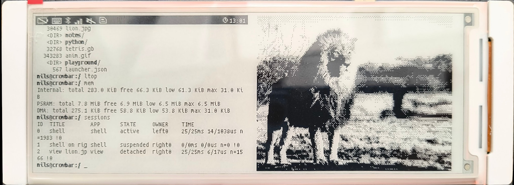

### 1, Product picture

### 2, Product version number

|      | Hardware | Software | Remark |
| ---- | -------- | -------- | ------ |
| 1    | V1.0     | V1.0     | latest |

### 3, product information

# Display Module Specifications
- **Size**: 5.79 inch
- **MCU**: ESP32-S3-WROOM-1-N8R8, up to 240 MHz
- **Flash**: 8 MB
- **PSRAM**: 8 MB
- **Material**: Active Matrix Electrophoretic Display (AM EPD)
- **Driver Chip**: SSD1683*2
- **Resolution**: 272(H)*792(L) Pixel
- **Pixel Pitch**: 0.1755*0.1755
- **Viewing Angle**: Full Viewing Angle
- **Communication Interface**: 3-/4-wire SPI, default 4-wire SPI
- **Interface**:
  - UART0 x1
  - BAT x1
  - GPIO x1
  - TF Card Slot x1
- **Button**:
  - Dial Switch x1
  - Menu Button x1
  - Back Button x1
  - REST Button x1
  - BOOT Button x1
- **Development Environment**: Arduino IDE、ESP IDF、MicroPython
- **Display Color**: Black and white
- **Refresh Mode**: Partial refresh (saves more power)
- **Display Voltage**: 2.2~3.7V
- **Operation Temperature**: -0~50℃
- **Storage Temperature**: -25~70℃
- **Active Area**: 47.74(H)\*139.00(L) (H*L)

### 4, Use the driver module

| Name    | dependency library     |
| ------- | ---------------------- |
| SSD1683 | EDP version=1.0.0 |

### 5, Quick Start

#### SolarOS

[SolarOS](https://solar-os.eu/) turns this CrowPanel into a pocket computer with a terminal, writing and reading apps, Wi-Fi, and Python scripting. Install prebuilt firmware directly from your browser:

1. Connect the CrowPanel to your computer with a USB data cable. Use Chrome or Edge on a desktop computer for browser flashing.
2. Open the [SolarOS Flasher for the CrowPanel 5.79-inch](https://solar-os.eu/flasher.html?board=elecrow_crowpanel_esp32_s3_5_79_epaper&flavor=writerdeck&layout=ota). This link selects **Elecrow CrowPanel ESP32-S3 5.79-inch E-paper**, the compact `writerdeck` flavor, and **OTA updates**. Use the latest available release.
3. Choose **Prepare image**, then read and accept the erase warning. Installation replaces the existing firmware and all data in the device's internal flash.
4. Choose **Connect and flash**, select the CrowPanel's serial port, and keep the cable connected until installation completes. Press **RESET** if the board does not restart automatically.
5. When the SolarOS shell appears, put a BLE keyboard into pairing mode. Hold the CrowPanel's **MENU** button for about two seconds, then release it when the keyboard icon changes to its pairing/scanning state. Once connected, type `help` to get started.

If flashing cannot enter download mode automatically, hold **BOOT**, tap **RESET**, then release **BOOT** and retry.

For a broader application selection, choose the `full` flavor and **Serial only** in the Flasher. This layout requires USB flashing for firmware updates. A FAT32 microSD card provides space for documents, scripts, and applications.

- [SolarOS quick start](https://solar-os.eu/quick-start.html): keyboard pairing, Wi-Fi setup, storage, and first commands.
- [CrowPanel 5.79-inch board guide](https://solar-os.eu/docs/manual/boards.html#elecrow-crowpanel-esp32-s3-5-79-inch-e-paper): board controls, display options, and building and flashing from source with the `elecrow_crowpanel_esp32_s3_5_79_epaper` PlatformIO environment.
- [SolarOS source code](https://github.com/nilseuropa/solar_os) and [user manual](https://solar-os.eu/docs/manual/overview.html).

#### Arduino IDE setup

1.Download the library files used by this product to the 'libraries' folder.

C:\Users\Documents\Arduino\libraries\

2.Open the Arduino IDE

3.Open the code configuration environment and burn it

### 6,Folder structure.

|--3D file： Contains 3D model files (.stp) for the hardware. These files can be used for visualization, enclosure design, or integration into CAD software.

|--Datasheet: Includes datasheets for components used in the project, providing detailed specifications, electrical characteristics, and pin configurations.

|--Eagle_SCH&PCB: Contains **Eagle CAD** schematic (`.sch`) and PCB layout (`.brd`) files. These are used for circuit design and PCB manufacturing.

|--example: Provides example code and projects to demonstrate how to use the hardware and libraries. These examples help users get started quickly.

|--factory_firmware: Stores pre-compiled factory firmware that can be directly flashed onto the device. This ensures the device runs the default functionality.

|--factory_sourcecode: Contains the source code for the factory firmware, allowing users to modify and rebuild the firmware as needed.

### 7,Pin definition

#define SCK 12

#define MOSI 11

#define RES 47

#define DC 46

#define CS 45

#define BUSY 48
